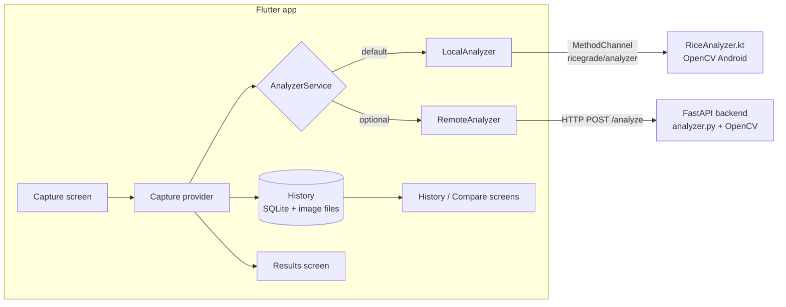

# RiceGrade 🌾

Take a photo of rice, and RiceGrade counts the grains, works out how many are broken and gives the sample a grade of **A**, **B** or **C**.

It is built for small rice shop owners and buyers who want a quick, consistent check of a sack without a lab. The analysis runs **on the phone or tablet itself**, so it works with no internet connection.

- Flutter app (Android tablet first, works on phones, light and dark mode)
- On-device image analysis with OpenCV (Kotlin)
- Optional Python/FastAPI backend that runs the same algorithm, ready for Hugging Face Spaces

> The YAML block at the top of this file is the configuration Hugging Face Spaces reads to deploy the backend. Leave it in place.

---

## Contents

- [What the app does](#what-the-app-does)
- [How the grading works](#how-the-grading-works)
- [Taking a good photo](#taking-a-good-photo)
- [Architecture](#architecture)
- [Project structure](#project-structure)
- [Getting started](#getting-started)
- [Backend API](#backend-api)
- [Configuration](#configuration)
- [Known limitations](#known-limitations)
- [Roadmap](#roadmap)
- [Credits](#credits)

---

## What the app does

### 1. Capture
Take a photo with the camera or choose one from the gallery. The app shows a preview before you analyze it. If camera or gallery permission is denied, the app explains how to turn it back on.

### 2. Result
The result screen is designed to be read at a glance:

- **A large card colored by grade**: green for A, yellow for B, red for C. It shows a plain sentence such as *"Good quality: 2% broken"* and what that means for selling.
- **"N grains checked"**, so you know how big the sample was.
- **The annotated photo**: every grain gets a box. **Green = whole**, **red = broken**.
- **Details** (tap to open): whole grains, broken grains and the average length/breadth ratio.
- **Save**: add a label such as *"Supplier A, sack 3"*.
- **Share**: send the result as text through WhatsApp, SMS, email, or any app.

### 3. History (works offline)
Every analysis is saved automatically on the device: the original photo, the annotated photo and all the numbers.

- Tap an entry to open its full result again.
- Swipe left to delete one, or use the clear-all button.
- Labels you added with **Save** appear in the list.

### 4. Compare two samples
In History, **long-press** one result, tap a second, then press **Compare**.

- The two samples are shown side by side on a tablet and one above the other on a phone.
- A table compares broken %, whole grains, broken grains, average length/breadth and grains counted. The lower broken % is highlighted as better.
- A plain verdict: *"About the same"* if the broken % differs by less than 2 percentage points, otherwise *"Supplier A has fewer broken grains (3% vs 9%)"*.
- A warning appears if either sample has fewer than 100 grains: *"Small sample, results may vary"*.

---

## How the grading works

The same steps run in both [`RiceAnalyzer.kt`](app/android/app/src/main/kotlin/com/example/ricegrade/RiceAnalyzer.kt) (on device) and [`backend/analyzer.py`](backend/analyzer.py) (server), with the same constants.

| Step | What happens | Why |
|---|---|---|
| 1. Resize | Long side scaled down to 1280 px | Keeps it fast on phones; enough detail for grains |
| 2. Grayscale + blur | 5×5 Gaussian blur | Removes noise and texture |
| 3. Threshold | Otsu's method picks the cut-off automatically. The image border decides the polarity, so light grains on a dark background and dark on light both work | Separates grains from background without manual tuning |
| 4. Clean up | 3×3 morphological opening | Removes dust and tiny specks |
| 5. Find grain centres | Distance transform. Each connected blob is seeded at 60% of *its own* maximum distance | Finds the middle of each grain, even inside a clump |
| 6. Split touching grains | Watershed | Separates grains that touch or overlap slightly |
| 7. Measure | Smallest rotated rectangle around each grain gives **length** (long side) and **breadth** (short side) | Works no matter which way a grain is lying |
| 8. Drop specks | Anything under 20% of the median grain area is ignored | Dust and fragments don't count as grains |
| 9. Whole or broken | A grain is **broken** if its length is under **75% of the median length** | Compares grains with each other, so no ruler or camera calibration is needed |
| 10. Grade | Based on the share of broken grains | See below |

| Grade | Broken grains | Shown as |
|---|---|---|
| **A** | 5% or less | Good quality (green) |
| **B** | over 5%, up to 15% | Fair quality (yellow) |
| **C** | over 15% | Low quality (red) |

**Average length/breadth ratio** is the mean of each grain's length divided by its breadth. Long, slender varieties (e.g. basmati) score higher than short, bold ones.

> These thresholds are the app's own defaults. They are not an official grading standard. Change them in both analyzer files if your market uses different limits.

---

## Taking a good photo

The result is only as good as the photo.

- **Plain, contrasting background**: white rice on a dark cloth or black paper works best.
- **Spread the grains out** in a single layer. A few touching grains are fine; large piles are not.
- **Even light**, no strong shadows. Daylight near a window is ideal.
- **Shoot straight down** from above, with the whole sample in frame.
- **Use a big enough sample**: aim for **100+ grains** for a reliable percentage.

---

## Architecture



- **`AnalyzerService`** is an interface with two implementations:
  - `LocalAnalyzer` calls native Kotlin code through a Flutter `MethodChannel`. The analysis runs on a background thread, so the UI never freezes.
  - `RemoteAnalyzer` uploads the photo to the backend.
- **State** is managed with Riverpod. `analyzerProvider` decides which analyzer is used.
- **History** is stored with `sqflite`. Photos are copied into the app's documents folder, so they survive even if the camera cache is cleared.

---

## Project structure

```
RiceGrade/
├── app/                         Flutter app
│   ├── lib/
│   │   ├── main.dart
│   │   ├── theme/theme.dart     Colors, spacing, grade colors (all styling lives here)
│   │   ├── routes/              go_router setup and the navigation shell
│   │   ├── services/
│   │   │   ├── analyzer_service.dart   LocalAnalyzer / RemoteAnalyzer + provider
│   │   │   ├── api_service.dart        HTTP client for the backend
│   │   │   └── history_repository.dart SQLite storage for history
│   │   └── features/
│   │       ├── capture/         Take or pick a photo
│   │       ├── results/         Grade card, details, save, share
│   │       └── history/         History list, selection, compare
│   └── android/app/src/main/kotlin/com/example/ricegrade/
│       ├── MainActivity.kt      MethodChannel "ricegrade/analyzer"
│       └── RiceAnalyzer.kt      OpenCV port of the analyzer
├── backend/
│   ├── main.py                  FastAPI app
│   ├── analyzer.py              OpenCV pipeline
│   └── requirements.txt
└── Dockerfile                   Backend image for Hugging Face Spaces
```

---

## Getting started

### Requirements

- [Flutter](https://docs.flutter.dev/get-started/install) (stable channel, Dart 3)
- Android Studio or the Android SDK, and an Android device or emulator (**arm64**; see [limitations](#known-limitations))
- Python 3.10+ (only if you want to run the backend)

### Run the app

```bash
git clone https://github.com/mil-create/RiceGrade.git
cd RiceGrade/app
flutter pub get
flutter run
```

The first Android build downloads OpenCV from Maven Central and takes a few minutes. Later builds are much faster.

Useful commands:

```bash
flutter analyze        # static checks
dart format lib        # format code
flutter build apk      # release APK in build/app/outputs/flutter-apk/
```

### Run the backend (optional)

The app does **not** need the backend; analysis runs on the device by default. The backend is useful for testing the algorithm on a computer, or for non-Android clients.

```bash
cd backend
python -m venv .venv
# Windows: .venv\Scripts\activate   macOS/Linux: source .venv/bin/activate
pip install -r requirements.txt
uvicorn main:app --reload
```

The API is then at `http://127.0.0.1:8000`, with interactive docs at `http://127.0.0.1:8000/docs`.

Try the analyzer directly on an image:

```bash
python analyzer.py path/to/rice.jpg   # prints metrics, writes annotated_rice.jpg
```

To reach a backend running on your laptop from a USB-connected tablet:

```bash
adb reverse tcp:8000 tcp:8000
```

### Deploy the backend to Hugging Face Spaces

1. Create a new Space and choose the **Docker** SDK.
2. Push this repository to the Space. The `Dockerfile` and the YAML header at the top of this README are all it needs.
3. The API is served on port `7860`.

---

## Backend API

### `GET /`
Health check. Returns `{"status": "ok"}`.

### `POST /analyze`
Upload an image as multipart form data in a field named `file`. The maximum size is 5 MB.

```bash
curl -F "file=@rice.jpg" http://127.0.0.1:8000/analyze
```

Response:

```json
{
  "whole_count": 118,
  "broken_count": 4,
  "broken_percent": 3.28,
  "avg_length_breadth_ratio": 3.12,
  "grade": "A",
  "annotated_image_base64": "iVBORw0KGgo..."
}
```

| Status | Meaning |
|---|---|
| 400 | Not an image, or the image could not be decoded |
| 413 | File is larger than 5 MB |

The on-device analyzer returns exactly the same fields, so the app treats both sources the same way.

---

## Configuration

| What | Where |
|---|---|
| Use the backend instead of on-device analysis | `analyzerProvider` in [`analyzer_service.dart`](app/lib/services/analyzer_service.dart): return `RemoteAnalyzer()` |
| Backend URL | `_defaultBaseUrl` in [`api_service.dart`](app/lib/services/api_service.dart) |
| Grade limits, broken threshold, speck size | Constants at the top of [`analyzer.py`](backend/analyzer.py) **and** [`RiceAnalyzer.kt`](app/android/app/src/main/kotlin/com/example/ricegrade/RiceAnalyzer.kt). Keep them in sync |
| "About the same" margin and small-sample size | `sameQualityThreshold` and `minReliableGrains` in [`compare_provider.dart`](app/lib/features/history/compare_provider.dart) |
| Colors, spacing, grade colors | [`theme.dart`](app/lib/theme/theme.dart) |

---

## Known limitations

- **Android only for on-device analysis.** iOS, web and desktop have no native analyzer yet. On those platforms, switch to `RemoteAnalyzer`.
- **arm64 devices only.** The build includes only the `arm64-v8a` OpenCV library to keep the APK small. Most phones and tablets from the last several years are arm64; older 32-bit devices and x86 emulators won't run the analyzer.
- **Broken is relative, not absolute.** Grains are compared with the median grain in the same photo. A sample made mostly of broken grains can therefore look better than it is.
- **Heavily piled or overlapping grains** are not always split correctly.
- **The home screen is a placeholder.**
- **No automated tests yet.**

---

## Roadmap

- Home screen with quick actions and recent results
- On-device analysis for iOS
- Export history (CSV / PDF)
- Settings screen for grade limits
- Unit tests for the analyzer and comparison logic

---

## Credits

Built with these open-source projects:

- [Flutter](https://flutter.dev/) and [Riverpod](https://riverpod.dev/), [go_router](https://pub.dev/packages/go_router), [image_picker](https://pub.dev/packages/image_picker), [dio](https://pub.dev/packages/dio), [sqflite](https://pub.dev/packages/sqflite), [path_provider](https://pub.dev/packages/path_provider), [share_plus](https://pub.dev/packages/share_plus)
- [OpenCV](https://opencv.org/) (Python and Android)
- [FastAPI](https://fastapi.tiangolo.com/) and [Uvicorn](https://www.uvicorn.org/)
- [Hugging Face Spaces](https://huggingface.co/spaces) for free hosting

The image-processing approach (Otsu thresholding, distance transform, watershed segmentation) follows standard OpenCV techniques described in the [OpenCV documentation](https://docs.opencv.org/4.x/d3/db4/tutorial_py_watershed.html).
